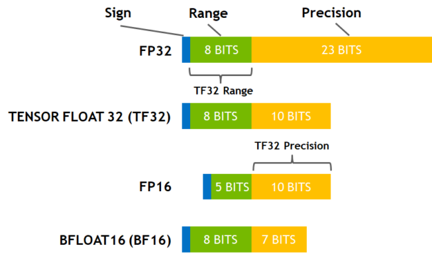
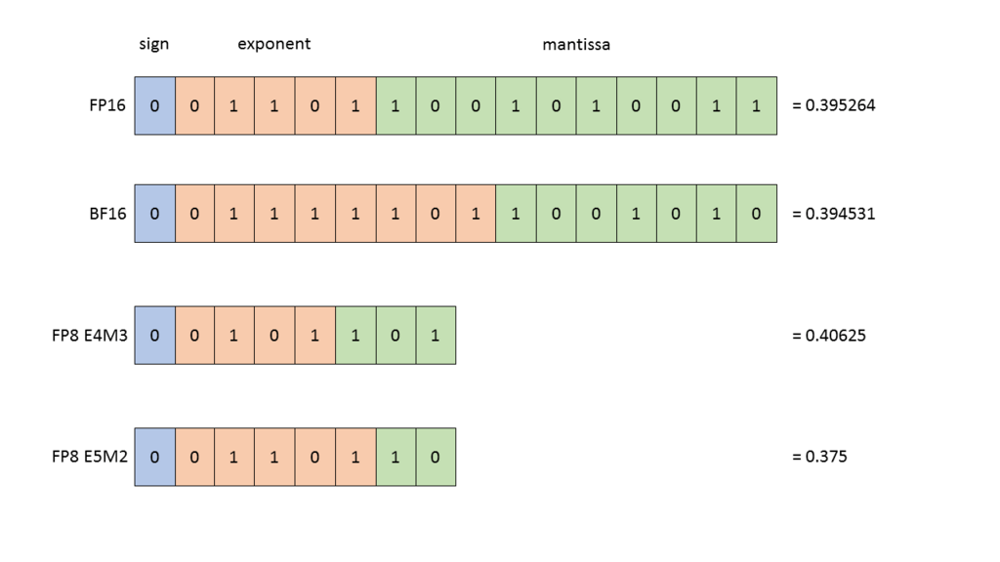
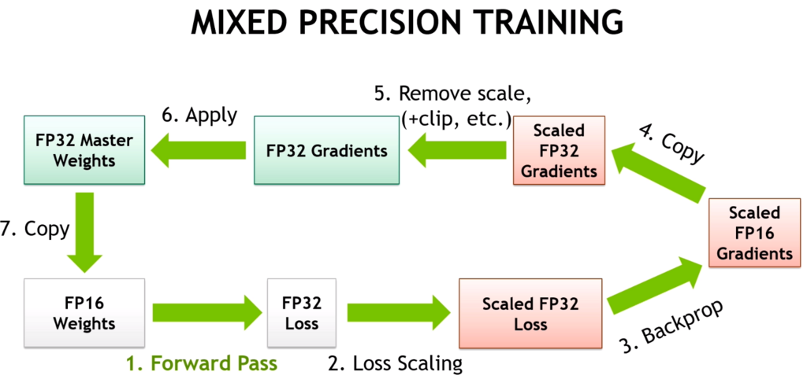

# 张量精度／数据类型

截至 2026 年 8 月，机器学习中常用的数据类型（通常称为 `dtype`）如下。

浮点格式：
- fp32：32 位
- tf32：19 位（NVIDIA Ampere 及更新架构）
- fp16：16 位
- bf16：16 位
- fp8：8 位（E4M3 和 E5M2 格式）
- fp6：6 位
- fp4：4 位

可以通过下面的表示方式直观比较：



（[来源](https://developer.nvidia.com/blog/accelerating-ai-training-with-tf32-tensor-cores/)）



（[来源](https://docs.nvidia.com/deeplearning/transformer-engine/user-guide/examples/fp8_primer.html)）

新硬件正在采用的新格式包括：
- fp4：`float4_e2m1fn`
- fp6：`float6_e2m3fn` 和 `float6_e3m2fn`
- fp8：`float8_e3m4`、`float8_e4m3`、`float8_e4m3b11fnuz`、`float8_e4m3fn`、`float8_e4m3fnuz`、`float8_e5m2`、`float8_e5m2fnuz`、`float8_e8m0fnu`

[这里](https://github.com/jax-ml/ml_dtypes?tab=readme-ov-file#specifications-of-implemented-floating-point-formats)对每种变体都有很好的解释。

`float8_e8m0fnu` 在这份列表中比较特殊：它不是元素格式，而是分块缩放格式附加给一组元素的共享缩放因子，因此没有尾数。把它与 4 位、6 位或 8 位元素编码配对，就形成了加速器规格中所说的 `MXFP4`／`MXFP6`／`MXFP8`：每块包含 32 个值，共享一个 `E8M0` 缩放因子。[模型权重](../inference/README.md#model-weights)一节计算了它们每个参数所需的字节数。NVIDIA 的 [`NVFP4`](https://developer.nvidia.com/blog/introducing-nvfp4-for-efficient-and-accurate-low-precision-inference/) 也采用这种两部分组成的思路，但配置不同：元素同样使用 `E2M1`，每块却只有 16 个元素，采用 `E4M3` 缩放因子，并为整个张量额外设置一个 fp32 缩放因子。与只能表示 2 的幂次的 `E8M0` 缩放因子相比，这样可以更贴合局部动态范围。

数字前面的字母含义如下：
- `e` 表示指数的位数。
- `m` 表示尾数的位数。
- `b` 表示偏置。

数字后面的字母含义如下：
- `f` 表示只包含有限值，不包含无穷大。
- `n` 表示包含 NaN，但仅在取值范围的最外端。
- `u` 表示无符号格式。
- `uz` 表示无符号零。

例如，`float8_e4m3b11fnuz` 表示：fp8 + 4 位指数 + 3 位尾数 + 偏置 11 + 仅有限值 + 仅在范围最外端包含 NaN + 无符号零。

量化使用的整数格式包括：

- int8：8 位
- int4：4 位
- int1：1 位

## 机器学习数据类型的演进

最初机器学习使用 fp32，但速度很慢。

后来，人们发明了结合 fp16 和 fp32 的[混合精度](https://developer.nvidia.com/blog/video-mixed-precision-techniques-tensor-cores-deep-learning/)，大幅提高了训练速度。



（[来源](https://developer.nvidia.com/blog/video-mixed-precision-techniques-tensor-cores-deep-learning/)）

但实践证明 fp16 不够稳定，训练 LLM 极其困难。

幸运的是，bf16 出现了，并在沿用同样混合精度机制的情况下替代了 fp16。这让 LLM 训练稳定得多。

随后 fp8 出现，混合精度可以切换到[这种格式](https://docs.nvidia.com/deeplearning/transformer-engine/user-guide/examples/fp8_primer.html)，进一步提高训练速度。参见 [FP8 Formats for Deep Learning](https://arxiv.org/abs/2209.05433)。截至 2026 年 8 月，大多数训练任务仍默认使用 bf16 混合精度，但 fp8 训练已经不再只是实验：[DeepSeek-V3](https://arxiv.org/abs/2412.19437) 就是用 fp8 训练的。

之后，Blackwell 增加了 fp6、fp4 和 NVIDIA 自己的 nvfp4。目前它们主要用于推理，不过 nvfp4 预训练方案也已经开始出现，参见 [FP4 格式](#fp4-formats)。

为了理解不同格式之间的加速幅度，下面列出 NVIDIA B200 的 TFLOPS 规格（不使用稀疏性），以及最早在非 CPU 硬件中支持相应数据类型的加速器（CPU 不擅长深度学习）。表格按 `B200 TFLOPS` 升序排列；如果多种类型速度相同，则按获得硬件支持的年份排序。

| 数据类型 | B200 TFLOPS | 最早的硬件支持 |
| :-------- | ----------: | :--------------------------------------------------- |
| fp32 | 80 | 早于机器学习加速器出现 |
| tf32 | 1125 | NVIDIA A100（Ampere，2020） |
| fp16 | 2250 | NVIDIA P100（Pascal，2016） |
| bf16 | 2250 | Google TPU v2（2017）<br>NVIDIA A100（Ampere，2020） |
| int8 | 4500 | Google TPU v1（2015）<br>NVIDIA P4/P40（Pascal，2016） |
| fp8 | 4500 | NVIDIA H100（Hopper，2022）<br>Intel Gaudi 2（2022） |
| fp6 | 4500 | NVIDIA B200（Blackwell，2024） |
| mxfp4 | 9000 | NVIDIA B200（Blackwell，2024） |
| nvfp4 | 9000 | NVIDIA B200（Blackwell，2024） |

int8 的单位实际是 TOPS，而不是 TFLOPS，因为执行的是整数运算。

其中有些日期表示某种数据类型开始可用的时间，而不是开始具备高性能的时间。P100 能以 fp32 两倍的速率进行 fp16 运算，但直到 2017 年 V100 的 Tensor Core 出现，fp16 `matmul` 才真正快起来。Pascal 的 int8 支持来自 `DP4A` 点积指令；int8 Tensor Core 则到 2018 年 Turing 架构才出现。

吞吐量翻倍的规律一直延续到 fp8：元素位宽每减半，吞吐量大约翻倍。随后这个规律中断了：fp6 与 fp8 都是 4500 TFLOPS，因此它节省显存和带宽，却不会增加计算吞吐量。fp4 相对于 fp8 再次翻倍，在 GB300 上则达到 3 倍（15000 对 5000）。所以，不要假定这个规律会一直延续，应检查实际计划使用的数据类型的规格。

在混合精度训练发展的同时，机器学习社区也提出了各种量化方法。其中一个出色的例子是 Tim Dettmers 的 [bitsandbytes](https://github.com/bitsandbytes-foundation/bitsandbytes)，它提供了许多 4 位和 8 位量化方案。DeepSpeed 也有一些[值得关注的量化方案](https://www.deepspeed.ai/tutorials/model-compression/)。

## FP4 格式

fp4 的 `e2m1` 元素有 16 种位模式：±0、±0.5、±1、±1.5、±2、±3、±4 和 ±6。仅靠一个缩放因子，远不足以用这么少的取值覆盖整个张量的范围，因此 fp4 必须采用分块缩放才实用：每个小块中的元素共享一个缩放因子，将这些值伸缩到该块的实际范围。两种分块缩放的 fp4 格式只有缩放因子不同。下面按块大小降序排列。

| 格式 | 块大小 | 块缩放因子 | 每元素位数 | 定义方 | 硬件 |
| :----- | ------------: | :----------------------------- | ------------------: | :---------- | :----------------------------------------------------------- |
| mxfp4 | 32 | `E8M0` | 4.25 | OCP MX 规范 | NVIDIA Blackwell<br>AMD MI350X/MI355X<br>Huawei Ascend 950DT |
| nvfp4 | 16 | `E4M3`<br>加上每个张量一个 FP32 缩放因子 | 4.5 | NVIDIA | 仅 NVIDIA<br>Blackwell 及更新架构 |

块大小以元素个数为单位，每元素位数包含了它分摊的块缩放因子开销。`E8M0` 缩放因子是 2 的幂次；nvfp4 则在 `E4M3` 块缩放因子之外，为每个张量增加一个 FP32 缩放因子。OCP MX 是 Open Compute Project 的 Microscaling 规范。

两者的区别不在速度。NVIDIA Blackwell 的 Tensor Core 通过同一条指令执行这两种格式，峰值性能相同，因此[理论 TFLOPS 表](../compute/accelerator/README.md#tflops-comparison-table)中两列数值一致。在 B200 上使用 torch 2.14 [实测](../compute/accelerator/README.md#maximum-achievable-and-sustainable-matmul-flops-comparison-table)，nvfp4 的 MAMF（6746 对 6183 TFLOPS）和 MSMF（5627 对 5222 TFLOPS）都比 mxfp4 快 8–9%；这是软件差异，而不是硬件差异。

真正的区别是精度。块更小，意味着一个离群值影响的是其他 15 个元素的缩放，而不是 31 个；`E4M3` 缩放因子也能落在相邻的 2 的幂次之间，而 `E8M0` 必须舍入到某个幂次。在 NVIDIA 的[80 亿参数、1 万亿 token 预训练对比](https://developer.nvidia.com/blog/train-models-faster-with-jax-and-maxtext-using-nvfp4-on-nvidia-blackwell/)中，MXFP4 需要多约 36% 的 token 才能达到 NVFP4 的最终损失。推理方面也可参见 [Introducing NVFP4](https://developer.nvidia.com/blog/introducing-nvfp4-for-efficient-and-accurate-low-precision-inference/)。这两项结论均来自 NVIDIA 自己的报告。

因此：
- 在 NVIDIA Blackwell 及更新硬件上，使用 nvfp4：计算能力相同，精度更好，代价是每个元素额外增加 0.25 位。
- 在不支持 nvfp4 的硬件上使用 mxfp4，例如 AMD MI355X 和其他实现 OCP MX 的非 NVIDIA 加速器；需要同一份检查点运行于多个厂商的硬件时，也适合使用 mxfp4。
- 如果模型发布时已经采用其中一种格式，例如 OpenAI 的 gpt-oss 以 MXFP4 发布 MoE 权重，直接使用该格式运行就能避免重新量化。

## TF32

TF32 是 NVIDIA 从 Ampere 架构开始支持的一种特别的数据类型，能够以少量精度损失为代价，让 fp32 `matmul` 的速度远高于普通 fp32 `matmul`。

以 A100 的 TFLOPS（不使用稀疏性）为例：

| 数据类型 | TFLOPS |
| :--- | --: |
| FP32 | 19.5 |
| Tensor Float 32（TF32） | 156 |

可以看到，TF32 的速度是 FP32 的 8 倍！

它默认关闭。要启用它，在程序开头加入：

```python
torch.backends.cuda.matmul.allow_tf32 = True
torch.backends.cudnn.allow_tf32 = True
```

关于实际精度损失的更多信息，请参见[这里](https://docs.pytorch.org/docs/stable/notes/cuda.html#tensorfloat-32-tf32-on-ampere-and-later-devices)。

## 何时使用 fp32 累加器

使用低精度数据类型时，必须小心，不要直接用该类型累加中间结果。

`LayerNorm` 一类操作不能全部用半精度计算，否则可能丢失大量信息。因此，正确的实现会使用输入的数据类型进行高效的内部计算，但采用 fp32 累加寄存器，然后再将输出转换回输入精度。

一般只有累加部分采用 fp32，因为对大量低精度数值求和，否则会造成很大的精度损失。

下面列举几个例子。

1. 归约类集体通信

* fp16：使用损失缩放时，可以用 fp16 执行。
* bf16：只能使用 fp32 才合适。

2. 梯度累积

* 无论 fp16 还是 bf16，最好都用 fp32；对于 bf16，则一定要这样做。

3. 优化器更新／梯度消失

* 将很小的梯度加到一个很大的数上时，这次加法往往会因精度不足而不起作用，因此通常使用 fp32 主权重和 fp32 优化器状态。
* 如果采用 [Kahan 求和](https://en.wikipedia.org/wiki/Kahan_summation_algorithm)或[随机舍入](https://en.wikipedia.org/wiki/Rounding)（[Revisiting BFloat16 Training](https://arxiv.org/abs/2010.06192) 中介绍），也可以使用 fp16 主权重和优化器状态。

后一种情况的例子可参见 [AnyPrecision 优化器](https://github.com/pytorch/torchdistx/pull/52)，最新版本在[这里](https://github.com/facebookresearch/multimodal/blob/6bf3779a064dc72cde48793521a5be151695fc62/torchmultimodal/modules/optimizers/anyprecision.py#L17)。

## 训练后更改精度

有时可以在模型训练结束后更改精度。

- 将 bf16 预训练模型用于 fp16 模式通常会失败，原因是溢出：fp16 能表示的最大数约为 64k。详细讨论和可能的解决方法参见这个 [PR](https://github.com/huggingface/transformers/pull/10956)。
- 将 fp16 预训练模型用于 bf16 模式通常可行。转换会损失一些模型表现，但应该能正常工作；使用前最好再做少量微调。
