# 理解训练损失曲线的形态

训练损失曲线有点像心跳图：有正常的、有异常的，也有需要警惕的。研究过许多训练损失轨迹后，就会逐渐形成直觉，能够解释训练过程中的各种损失行为，并判断应该采取什么行动。

需要先说明，标题中的“理解”有多重含义，因为很多时候，我们其实并不知道某类尖峰为什么发生。这里的“理解”主要指识别不同形态。识别之后，通常可以用一些方法克服不良形态，让训练顺利完成。

因此，这里展示的是一组训练损失形态：有时能给出确切解释，但更多时候，只能根据经验推测可能发生了什么。

这些图表截图来自多年间的不同来源，样式差异很大，还请见谅。

## 正常、异常与意外的形态

下面来看一些正常、异常和不寻常的形态。

### 一次非常失败的训练

启动 BLOOM-176B 训练前，我们对 [104B 模型](https://github.com/bigscience-workshop/bigscience/tree/master/train/tr8-104B-wide)做了多次实验，始终没能弄清如何避免模型在很早期就发散。

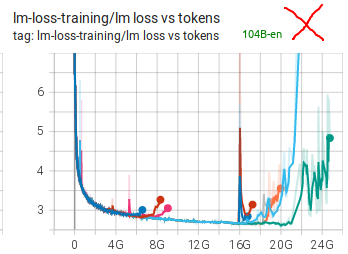

可以看到，我们进行了许多次尝试，也使用了许多方法，参见[训练纪事](https://github.com/bigscience-workshop/bigscience/blob/master/train/tr8-104B-wide/chronicles.md)。我们认为，两大主要障碍是使用 fp16，以及数据中包含大量垃圾内容。BLOOM-176B 训练时，我们改用 bf16、使用干净得多的数据，还增加了嵌入层的 LayerNorm，结果发生了根本变化。

### 一次近乎完美的训练

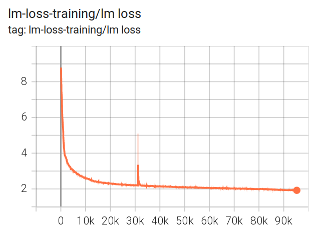

[BLOOM-176B](https://github.com/bigscience-workshop/bigscience/tree/master/train/tr11-176B-ml) 的训练损失轨迹近乎完美，只有一次尖峰，而且在 200 步内就恢复了。

可以在 [TensorBoard](https://huggingface.co/bigscience/tr11-176B-logs/tensorboard) 中放大查看，也可以检查其他曲线。

这确实是一次近乎完美的训练，背后投入了大量艰苦工作。

### 顿悟时刻

前段时间，我在做性能测试时，在一个配有 8×A100 的节点上，以很小的全局批量大小 8，从头训练 llama-2-7b。使用的是 DeepSpeed ZeRO-3 数据并行，以及 HF Transformers 的 [Llama](https://github.com/huggingface/transformers/tree/main/src/transformers/models/llama) 实现。

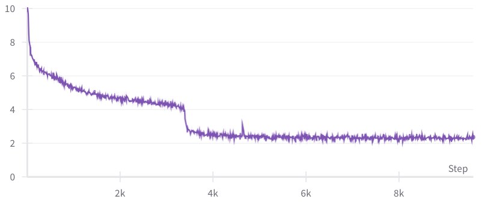

在长时间稳定但缓慢的改善之后，只经过 480 个样本，损失就迅速从 4 降到 2.5。我的同事 [Gautam Mittal](https://github.com/gmittal) 将其称为 [grokking](https://en.wikipedia.org/wiki/Grok)，即“顿悟”时刻。短短几步之内，模型突然实现了更好的泛化，能够更准确地预测后续 token。

使用大得多的批量时，通常看不到如此剧烈的改善。

放大后可以看到，这大约经历了 60 步，每步迭代 8 个样本：

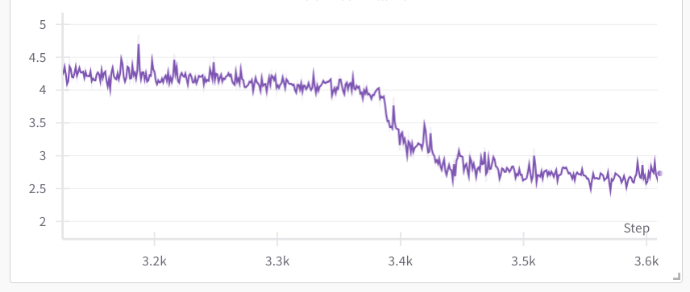

## 损失尖峰的主要类型

一般来说，损失尖峰有三种：

1. 快速恢复的尖峰
2. 缓慢恢复的尖峰
3. 无法完全恢复的尖峰

尖峰通常由一段不良数据引起，可能是数据打乱得不充分，也可能是网页抓取数据中的垃圾内容没有清理干净。

你可能怀疑尖峰出现前的那个批次是触发因素，但检查其内容时，往往找不到异常。问题常常在许多步之前就已经开始发展，然后突然显现。此外，检查一个批次也未必容易：全局批量大小和序列长度都很大时，单个批次的内容可能相当于一本书。

### 快速恢复的尖峰

损失尖峰可能经常出现，只要它们很快回到原先水平，训练通常就能像什么都没发生一样继续。

下面是 [BLOOM 正式训练前的 13B 实验](https://github.com/bigscience-workshop/bigscience/tree/master/train/tr1-13B-base)中的一个例子：

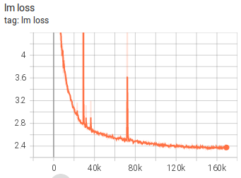

可以看到，尖峰很多，有些幅度很大，但都迅速恢复了。

### 缓慢恢复的尖峰

下面是 [IDEFICS-80B](https://github.com/huggingface/m4-logs/blob/master/tr-190-80b/chronicles.md) 训练中一次缓慢恢复的尖峰：

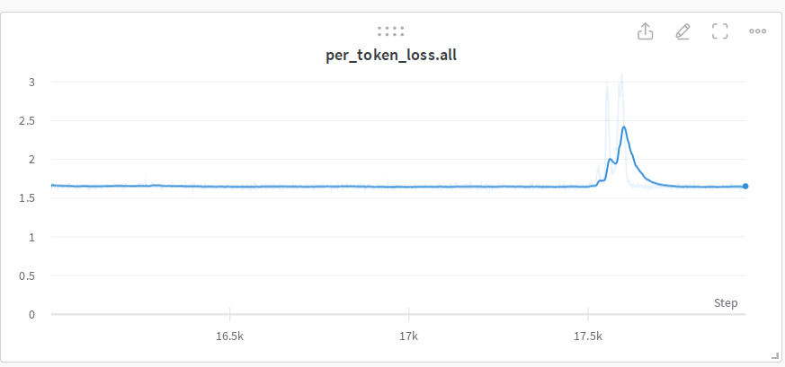

### 无法完全恢复的尖峰

这次 [104B 模型训练尝试](https://github.com/bigscience-workshop/bigscience/tree/master/train/tr8-104B-wide)出现尖峰后开始恢复，但未能完全恢复，随后反而开始发散。

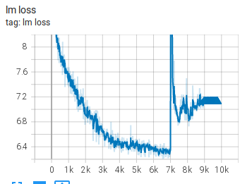

下面是 [IDEFICS-80B](https://github.com/huggingface/m4-logs/blob/master/tr-190-80b/chronicles.md) 训练中的另一个例子：

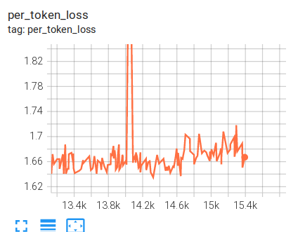

### 没有尖峰的发散

下面几个发散的例子并没有先出现尖峰：

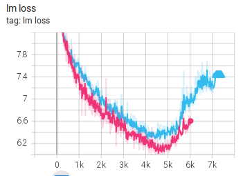

还有几个例子：

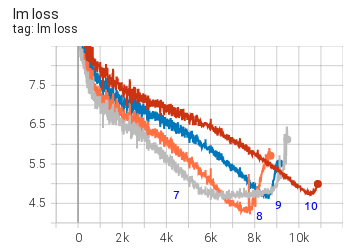

可以看到，每次重启都会取得一点进展，然后模型就发散。

这些都来自 [104B 模型的训练尝试](https://github.com/bigscience-workshop/bigscience/tree/master/train/tr8-104B-wide)。

### 多数据集的尖峰

训练 [IDEFICS-80B](https://github.com/huggingface/m4-logs/blob/master/tr-190-80b/chronicles.md) 时，我们混合使用了两种不同类型的数据集：

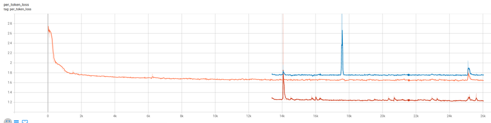

图例：cm4（上方）、平均值（中间）、pmd（下方）。

可以看到，有时两个数据集的损失会同时出现尖峰，有时则只有其中一个数据集的损失出现尖峰。

这里模型学习的是两种不同的数据分布。两种分布上的损失值以及尖峰行为并不相同。对模型而言，pmd 数据集比 cm4 数据集容易得多，因此损失也更低。

## 恢复训练引起的尖峰

因为硬件故障而恢复训练，或因为遇到发散而需要回滚到更早的检查点，几乎是不可避免的。如果训练软件无法完美恢复到让模型“察觉不到中断”的程度，就可能遇到各种问题。

恢复训练时，最复杂的挑战是恢复各种 RNG 状态，让 DataLoader 回到与恢复位置相对应的数据索引；如果使用了为自己的环境定制的复杂 DataLoader，还必须满足其他各种要求。

### DataSampler 相关问题

训练 [IDEFICS-80B](https://github.com/huggingface/m4-logs/blob/master/tr-190-80b/chronicles.md) 时，我们使用了非常复杂的 DataLoader。恢复它的状态时，图像与文本的比例会波动，因此每次恢复训练都会出现一个小尖峰，然后再恢复：

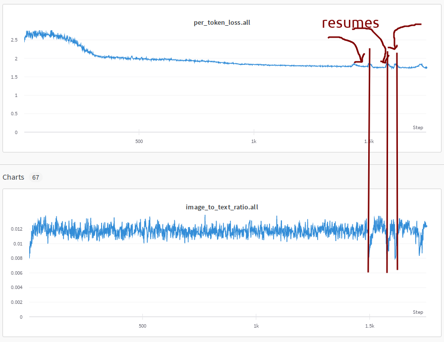

图中能看到损失曲线与比例曲线之间的相关性。因为我们恢复了大约十几次训练，所以观察到了很多这样的尖峰。

### 重复数据的影响

我训练一个 Llama2 变体时，观察到一个极不寻常的尖峰：它既没有继续发散，也没有恢复，而是转移到了一个新的、更高的损失水平。

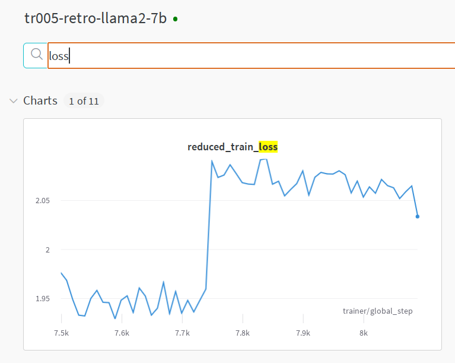

我回滚到异常行为发生前的位置，重新启动训练。损失先在原来的水平上运行了一段时间，随后又出现尖峰，转移到更高的损失水平。

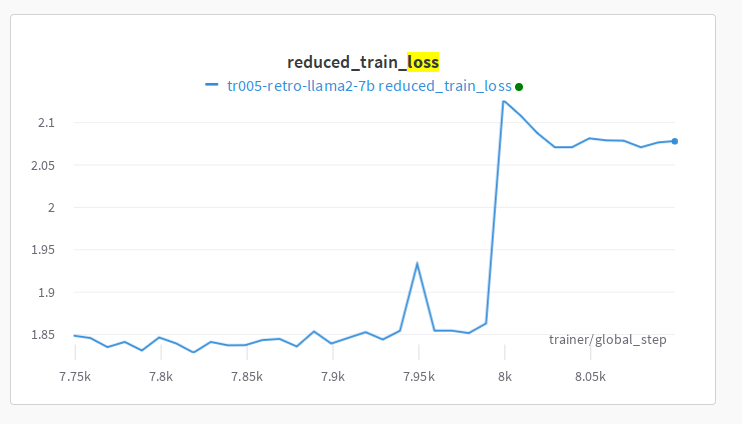

我以前从未见过这种发散，困惑了一阵之后，决定看看更完整的图景。

如果进行了回滚，[wandb](https://wandb.ai/) 当时不能正确绘制恢复训练后的数据：它会忽略回滚之后的新数据，直到步数超过旧数据已经到达的位置。因此，每次回滚并恢复训练时，我们都必须新建一张 wandb 曲线，才能看到新数据。要看完整曲线，就需要把它们拼起来，其中还会包含已经作废的数据点。我拼接后，看到了下面这个谜团：

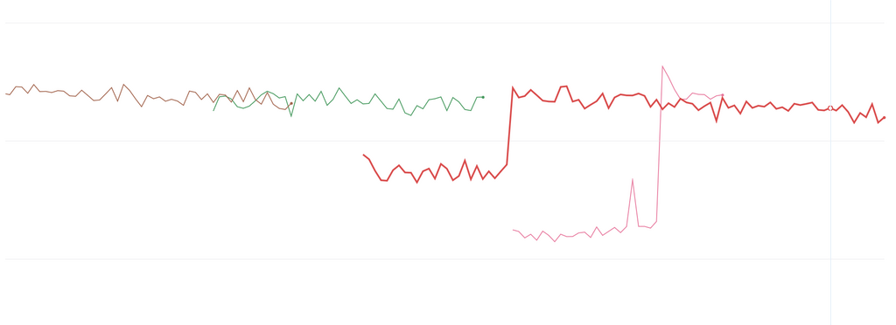

补充说明：截至 2025 年，wandb 已经能够正确处理这种情况。使用 `wandb.init(resume_from="<run_id>?_step=N")` [回退一次运行](https://docs.wandb.ai/models/runs/rewind)，会在第 `N` 步截断历史，并允许继续用同一 run id 记录后续数据；`fork_from` 也有类似效果，但会保留原始运行不变。要求 wandb SDK 0.17.1+；出于性能考虑，wandb 更推荐派生运行，而不是回退。还有两个限制：只支持云端的 Multi-tenant 和 Dedicated Cloud，不支持 Self-Managed；而且要求步数单调递增，不能配合非单调的 `define_metric()` 使用。自托管环境仍需采用上面的拼接方式。

前两次运行中其实并没有真正的尖峰，损失从一开始就没有上升。两次恢复训练都因为读取了完全重复的数据，而低报了损失；等到遇到以前没见过的数据，才恢复正确报告。换句话说，模型发生了过拟合，并给出了具有误导性的损失。

根因是数据重复。模型显然记住了其中一些内容，因此报告了更好的损失。

问题来自 [pytorch-lightning](https://github.com/Lightning-AI/pytorch-lightning)：它没有自动正确处理恢复训练时的 DataSampler 状态，基本上每次恢复都会从头开始读取数据流。这当然需要用户自行修正。可以更改种子，在一定程度上缓解问题、避免完全相同的数据顺序，但仍然会重复读取数据。这不是严肃训练所希望的；消融实验也一样，如果实验假设数据[独立同分布（IID）](https://en.wikipedia.org/wiki/Independent_and_identically_distributed_random_variables)，这些观察结果就会失效。

补充说明：我曾与 PTL 开发者[讨论这个问题](https://github.com/Lightning-AI/pytorch-lightning/issues/18780)。他们表示已经努力尝试寻找通用解决方案，但未能实现，因此需要用户自行处理。

务必检查训练框架文档，确认其是否正确处理 DataSampler 的恢复。不要等训练结束后才发现，本来计划让 300B 个 token 各被看到一次，实际却把同一批 50B token 重复训练了 6 遍。

正式训练前，先在早期做几次恢复训练，也有助于暴露问题。不过，如果每次恢复都会重新打乱数据，就不太容易看出来；只有种子相同时，这种现象才会明显显现。
